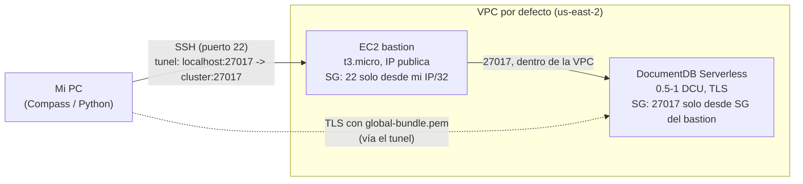

# Punto 3 — Amazon DocumentDB

## Objetivo

Desplegar DocumentDB de bajo costo, conectarme desde mi PC vía túnel SSH a través de una EC2 bastión, y desde Python (y MongoDB Compass) crear una base de datos, insertar documentos y ejecutar consultas.

## DocumentDB vs MongoDB — al menos 3 diferencias reales

Fuente oficial: [Functional differences: Amazon DocumentDB and MongoDB](https://docs.aws.amazon.com/documentdb/latest/developerguide/functional-differences.html) (AWS Documentation, consultado 2026-09-30).

1. **No es un motor MongoDB real, es una emulación de su API** sobre un motor propio de AWS con almacenamiento distribuido desacoplado del cómputo. Por esto, `explain()` y los planes de consulta pueden diferir de lo que muestra un MongoDB real, aunque el resultado funcional sea el mismo. Una app que dependa de analizar el plan de ejecución exacto (tuning fino) puede comportarse distinto al migrar.
2. **Retryable writes no soportado antes del engine 8.0.2.** La mayoría de drivers modernos de MongoDB los activan por defecto; si mi cluster corre una versión anterior, cualquier escritura falla con `MongoError 301` a menos que desactive `retryWrites` explícitamente en el connection string (`retryWrites=false`). Mi cluster corre `5.0.0`, así que tuve que desactivarlo en el código.
3. **Operadores y comportamientos con diferencias puntuales**: `$vectorSearch` no existe como operador independiente (va dentro de `$search`), `$elemMatch` dentro de `$all` no está soportado (hay que reescribir con `$and`), el orden de resultados no se garantiza sin `sort()` explícito, y solo se permite un `index build` a la vez por colección.
4. **TLS obligatorio y sin acceso público por diseño** — a diferencia de un MongoDB standalone/local, que por defecto no exige TLS ni bloquea el acceso externo. Esto es justamente lo que me obligó a montar el bastión y el túnel SSH de este punto.

Estas diferencias sí afectarían una aplicación existente que asuma retryable writes activado, dependa de analizar `explain()` al detalle, o use los operadores no soportados.

## Aprovisionado vs Serverless — con números

Precios verificados con la AWS Pricing API (región us-east-2, consultado 2026-09-30):

| Opción | Precio |
|---|---|
| Provisionado más chico (`db.t4g.medium`, storage estándar) | $0.07566/hora |
| Serverless, mínimo 0.5 DCU | $0.0822/DCU-hora × 0.5 = **$0.0411/hora** |
| Storage estándar | $0.10/GB-mes |
| Storage Serverless (elástico) | $0.30/GB-mes |
| IO requests | $0.20 por millón |

Para esta práctica (carga mínima, sesión corta de pruebas) **Serverless resultó ~46% más barato** que el provisionado más chico disponible, porque escala al mínimo de 0.5 DCU cuando no hay carga — exactamente mi caso. Por eso usé **DocumentDB Serverless** (`ServerlessV2ScalingConfiguration`: MinCapacity=0.5, MaxCapacity=1.0).

## Arquitectura de conexión

DocumentDB vive en la VPC por defecto, sin acceso público. Para conectarme desde mi PC:

- **SG del bastión**: solo puerto 22, solo desde mi IP pública (`/32`). Tuve que actualizarlo dos veces en la práctica porque mi IP de casa cambió (ISP con IP dinámica) — evidencia de por qué `/32` hay que mantenerlo al día, no es "configurar una vez y olvidar".
- **SG de DocumentDB**: solo puerto 27017, solo desde el *security group* del bastión (no desde una IP) — así nadie más en la VPC puede llegar directo, solo a través de mi bastión.
- **TLS**: DocumentDB lo exige por defecto. Descargué `global-bundle.pem` (bundle de CAs de RDS/DocumentDB) y lo usé como `tlsCAFile` tanto en Python como en Compass.
- **Por qué `tlsAllowInvalidHostnames=true`**: el certificado de DocumentDB está emitido para el hostname real del cluster (`taller-aws-eia-punto3-docdb-cluster.cluster-....docdb.amazonaws.com`), pero como me conecto a través del túnel SSH, mi cliente apunta a `127.0.0.1`/`localhost`. Sin esta opción, la validación TLS del hostname falla (`CERTIFICATE_VERIFY_FAILED: IP address mismatch`) aunque el certificado en sí sea válido y la CA correcta.

## Qué hice

1. Desplegué el bastión (`deploy.py create`): key pair propio, EC2 `t3.micro` con IP pública, SG restringido a mi IP.
2. Desplegué DocumentDB Serverless en la misma VPC, con su propio SG, contraseña maestra gestionada por Secrets Manager (`ManageMasterUserPassword=True` — nunca generé ni escribí yo la contraseña).
3. Levanté el túnel SSH (`ssh -L 27017:<endpoint-docdb>:27017 ec2-user@<ip-bastion>`).
4. Corrí `queries.py`: recupera la contraseña de Secrets Manager en tiempo de ejecución, conecta con `pymongo` (TLS + `tlsCAFile` + `tlsAllowInvalidHostnames=true` + `retryWrites=false` + `directConnection=true`), crea la base `taller_aws_eia` y la colección `estudiantes`, inserta 11 documentos, y corre:
   - **Filtro**: estudiantes de Ing. de Datos con promedio ≥ 4.2.
   - **Ordenación**: todos por promedio descendente.
   - **Agregación**: promedio de nota y conteo de estudiantes por programa (`$group` + `$avg` + `$sum` + `$sort`).
5. Verifiqué la misma conexión desde **MongoDB Compass** (autenticación con usuario/password recuperados de Secrets Manager, base de autenticación `admin` — el usuario maestro de DocumentDB vive ahí, no en la base de datos de la app; si se deja en blanco, Compass falla con `Authentication failed` aunque la contraseña esté bien).

Evidencia de código y resultados: [`deploy.py`](deploy.py), [`queries.py`](queries.py), [`../evidence/03/01_deploy_create_output.txt`](../evidence/03/01_deploy_create_output.txt), [`../evidence/03/02_queries_output.txt`](../evidence/03/02_queries_output.txt).

## Preguntas de costos

- **Qué opción cuesta menos**: Serverless (0.5 DCU mínimo), ~46% más barato que el provisionado más chico para esta práctica de carga mínima (ver tabla arriba).
- **Cuánto agrega la EC2 del túnel**: la instancia `t3.micro` del bastión cuesta **$0.0104/hora** adicionales — nada del tráfico de datos en sí, solo por tener la instancia encendida. Sumado a DocumentDB Serverless, el total del stack es **~$0.0515/hora**.

## Resultados

| Consulta | Qué responde |
|---|---|
| Filtro | Cuáles estudiantes de mi programa (Ing. de Datos) tienen buen promedio (≥4.2) |
| Ordenación | Ranking completo de estudiantes por promedio |
| Agregación | Comparar el desempeño promedio entre programas (Ing. de Datos salió con el promedio más alto: 4.38) |

Capturas (en `evidencias-taller-aws.docx`, local): bastión EC2, cluster + instancia DocumentDB, Compass conectado mostrando los 11 documentos, y el secreto en Secrets Manager.

## Checklist de cierre

- [x] Recursos con tags `Project=taller-aws-eia`, `Punto=3`, `Owner=Luis Brito Rincon`.
- [x] Contraseña de DocumentDB gestionada por Secrets Manager, nunca en código.
- [x] Conexión verificada desde Python y desde Compass.
- [x] ≥10 documentos insertados, filtro + orden + agregación ejecutados.
- [x] Diagrama de conexión (Mermaid, arriba).
- [x] Preguntas de costos respondidas con precios verificados.
- [x] Recursos destruidos + verificación: instancia, cluster, subnet group, bastión, security groups, key pair y secreto — todos confirmados eliminados ([`../evidence/03/03_destroy_verificacion.txt`](../evidence/03/03_destroy_verificacion.txt)).

## Nota sobre el script de destroy

Al primer intento, `deploy.py destroy` crasheó porque intenté usar `docdb.get_waiter("db_cluster_deleted")` — ese waiter no existe en boto3 para DocumentDB (solo hay `db_instance_available` y `db_instance_deleted`). Lo corregí haciendo polling manual con `describe_db_clusters` hasta que devuelve `DBClusterNotFoundFault`. El bug ya está corregido en el script.
