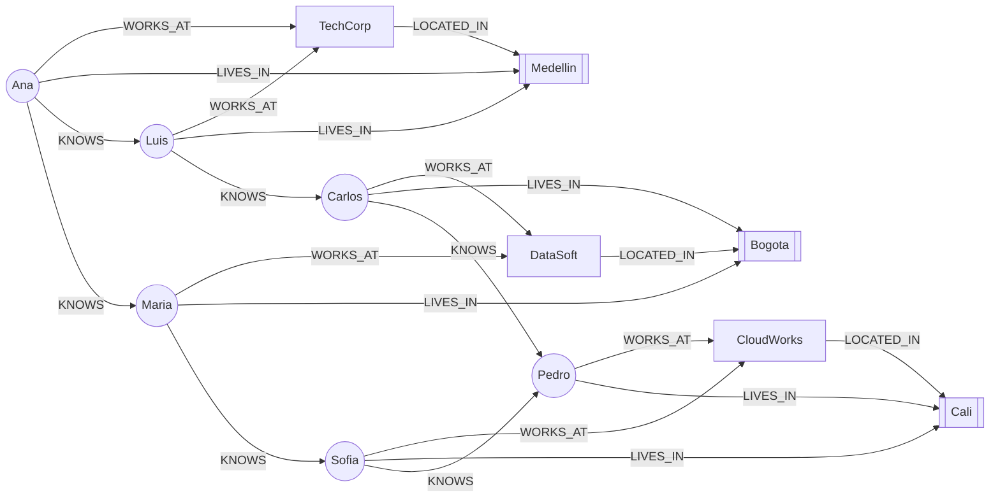

# Punto 4 — Amazon Neptune

## Objetivo

Desplegar Neptune de bajo costo, definir cómo conectarme desde mi PC, modelar un grafo (personas, empresas, ciudades) con al menos 10 vértices y 15 aristas, e insertar/consultar desde Python con 3 recorridos multi-salto.

## Neptune vs Neo4j

Fuente oficial: [docs.aws.amazon.com/neptune/.../intro.html](https://docs.aws.amazon.com/neptune/latest/userguide/intro.html), consultado 2026-10-02.

| | Neptune | Neo4j |
|---|---|---|
| Modelo de datos | Property graph **y** RDF, sobre el mismo motor | Solo property graph nativo |
| Lenguajes de consulta | Gremlin (Apache TinkerPop), openCypher, SPARQL (para RDF) | Cypher |
| Herramientas | Notebooks Jupyter gestionados por AWS (`graph-notebook`), Neptune Graph Explorer | Neo4j Browser/Desktop, Bloom (visualización), GDS (algoritmos de grafo), APOC (librería de procedimientos) |

Usé Gremlin desde Python (`gremlinpython`) porque es el lenguaje nativo de property graphs en Neptune y lo que ya tenía en `requirements.txt`.

## Aprovisionado vs Serverless — con números

Precios verificados con la AWS Pricing API (región us-east-2, consultado 2026-10-02):

| Opción | Precio |
|---|---|
| Provisionado más chico (`db.t4g.medium`) | **$0.093/hora** |
| Serverless, mínimo **1.0 NCU** (no 0.5 como DocumentDB) | $0.1608/NCU-hora × 1.0 = **$0.1608/hora** |

A diferencia de DocumentDB (donde Serverless ganaba), acá **gana el provisionado**: el piso de Neptune Serverless es más caro que la instancia más chica disponible. Usé `db.t4g.medium` aprovisionado.

## Cómo me conecto — y por qué otra vez EC2 + SSH

Confirmé con `aws neptune create-db-cluster help` que Neptune **no tiene** el parámetro `--publicly-accessible` que sí tienen RDS/DocumentDB: un cluster de Neptune **nunca** tiene endpoint público, sin excepción de versión.

Las alternativas sin túnel SSH (SSM Session Manager, notebook de Neptune gestionado) necesitan un **rol IAM** adjunto a la instancia/notebook — y ya confirmé en los puntos 1 y 3 que mi usuario no tiene ningún permiso para crear roles IAM (lo gestiona el profesor centralizadamente). Por eso reutilicé el mismo patrón de bastión EC2 + túnel SSH del Punto 3.

**¿Es necesario el proceso con EC2?** Sí, en mi caso, porque Neptune no tiene acceso público y no puedo crear el rol IAM que pedirían las alternativas. **¿Existe otra manera?** Conceptualmente sí (SSM port forwarding sin exponer el puerto 22, o un notebook de Neptune que corre dentro de la VPC sin necesidad de túnel local) — pero ambas requieren un rol IAM que no puedo crear en esta cuenta.

Mientras hacía la prueba mi IP de casa cambió (otra vez, van tres veces en el taller) — el script `deploy.py` tiene un comando `update-ip` que detecta mi IP actual y actualiza el security group del bastión sin tener que hacerlo a mano.

## Modelo del grafo

Dominio: personas, empresas, ciudades. 12 vértices, 21 aristas.

- 6 vértices `person`, 3 `company`, 3 `city`.
- Aristas: `WORKS_AT` (6), `LIVES_IN` (6), `LOCATED_IN` (3), `KNOWS` (6) = 21 en total.

## Qué hice

1. Desplegué el bastión EC2 y el cluster Neptune aprovisionado (`deploy.py create`) — sin usuario/contraseña de base de datos: Neptune controla el acceso por security group (y opcionalmente IAM SigV4, que no habilité), así que **no hay ningún secreto de Secrets Manager en este punto**.
2. Levanté el túnel SSH al puerto 8182 (el de Neptune/Gremlin).
3. Corrí `queries.py`: cargué el grafo completo por Gremlin y ejecuté 3 consultas multi-salto.
4. Bug real que encontré: `gremlinpython` 3.8.1 (la versión que tenía instalada) no es compatible con el motor de Neptune 1.4.8.0 — el paso `drop()` fallaba con `Unable to find Traversal steps for the graph operator: discard`. Neptune 1.4.x soporta Apache TinkerPop 3.7.x, así que bajé la versión a `gremlinpython==3.7.2` (ya actualizado en `requirements.txt`) y funcionó.
5. Destruí todo y verifiqué.

## Las 3 consultas

| Consulta | Qué responde | Resultado |
|---|---|---|
| Amigos de amigos de Ana (2 saltos por `KNOWS`) | A quién le podría recomendar como contacto, aunque no se conozcan directo | Amigos directos: Maria, Luis. A 2 saltos: Sofia, Carlos |
| Persona → empresa → ciudad (camino de 2 saltos) | En qué ciudad queda la empresa de cada persona (sin que la persona tenga directamente ese dato) | Ana/Luis → TechCorp → Medellín; Maria/Carlos → DataSoft → Bogotá; Sofia/Pedro → CloudWorks → Cali |
| Compañeros de trabajo (`person -> company <- person`) | Quién trabaja con quién, sin que exista una arista directa entre ellos | Ana-Luis, Maria-Carlos, Sofia-Pedro (cada par comparte empresa) |

Evidencia completa: [`../evidence/04/01_deploy_create_output.txt`](../evidence/04/01_deploy_create_output.txt), [`../evidence/04/02_queries_output.txt`](../evidence/04/02_queries_output.txt).

## Preguntas de costos

- **Cómputo**: `db.t4g.medium` aprovisionado, **$0.093/hora**.
- **Almacenamiento**: $0.10/GB-mes (storage estándar) — a este tamaño de prueba (unos pocos KB), despreciable.
- **¿Mi método de conexión añade una EC2?** Sí, el bastión `t3.micro` agrega **$0.0104/hora**. Total del stack: **~$0.103/hora**.
- **¿Qué sigue cobrando si no ejecuto consultas?** La instancia de Neptune sigue facturando por hora mientras esté encendida (aprovisionado no escala a cero), el storage se cobra por lo que ocupan los datos guardados (independiente del tráfico), y la EC2 bastión sigue cobrando por hora mientras esté prendida, tenga o no una sesión SSH activa.

## Checklist de cierre

- [x] Recursos con tags `Project=taller-aws-eia`, `Punto=4`, `Owner=Luis Brito Rincon`.
- [x] Sin secreto de Secrets Manager (Neptune no usa contraseña de BD) — explicado arriba.
- [x] Grafo con 12 vértices y 21 aristas (mínimo pedido: 10 y 15).
- [x] 3 consultas multi-salto ejecutadas desde Python.
- [x] Diagrama del grafo (Mermaid, arriba) y arquitectura de acceso documentada.
- [x] Preguntas de costos respondidas con precios verificados.
- [x] Recursos destruidos + verificación: instancia, cluster, bastión, security groups y key pair confirmados eliminados ([`../evidence/04/03_destroy_verificacion.txt`](../evidence/04/03_destroy_verificacion.txt)).
